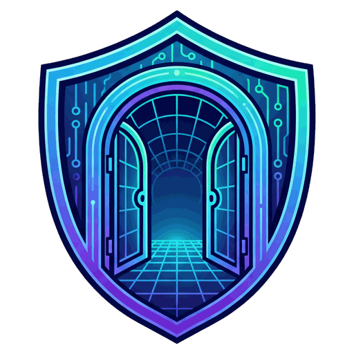

<p align="center"></p>

# Portal-NG

[](https://github.com/SkouedLabs/Portal/actions/workflows/ci.yml)
[](LICENSE)
[](backend/requirements.txt)
[](frontend/package.json)
[](docs/README.md)

A **company portal**: one page where everyone finds the applications they are entitled to, inspired by
[Homer](https://github.com/bastienwirtz/homer).

It keeps Homer's card-and-section look and the feeling of a page that loads instantly, and adds what Homer
leaves to you because it has no server: **several dashboards** with their own rights, **administration from
the interface** instead of a YAML file to redeploy, **LDAP / Active Directory and OpenID Connect** sign-in
with two-step verification, **status checks** probed by the server rather than the browser, and
**navigation logs**. An existing Homer instance is imported as it is, images included.

## What you get

- **Dashboards, Homer-style**: sections, cards, tags, a message banner, navigation links, a search key,
  light and dark themes, a column or list layout — and **one dashboard per audience**, each with its own
  colours, background and access rules.
- **Everything from the interface**: the editor, the 2 000+ bundled Font Awesome icons with a search, the
  colours, the backgrounds and the branding. Nothing to redeploy to change a link.
- **Sign-in that fits a company**: [local accounts, LDAP / Active Directory or OpenID
  Connect](docs/users-and-rights.md) with group synchronisation, [two-step
  verification](docs/users-and-rights.md#two-step-verification) (authenticator apps, security keys and
  passkeys), and [rights per dashboard](docs/users-and-rights.md#access-rules) granted to a group or a
  single person, to view or to edit.
- **[Status checks](docs/monitoring.md#status-checks)**: a green, orange or red dot on each card with the
  HTTP code and the latency. The **backend** probes, so internal applications work and there is no CORS or
  mixed-content problem.
- **[Migration from Homer](docs/homer.md)**: point the importer at Homer's `assets` folder and every page
  becomes a dashboard, with its colours, its background and its local images uploaded for you.
- **[Logs](docs/monitoring.md#logs)**: dashboards viewed, links opened, sign-ins and failures, MFA events,
  administrative actions — with filters, statistics and a CSV export.
- **[Images that stay light](docs/branding.md#images-and-how-they-are-stored)**: every logo and background
  is scaled down and re-encoded to WebP as it is uploaded, so a 2 MB picture does not become 2 MB on every
  page load.

It also **needs no internet access at runtime** — no CDN, no external font, no telemetry — which is the
whole point for a portal that lives on an internal network. See [Offline
installation](docs/install.md#offline-air-gapped-installation).

## Quick start

Docker Engine 24+ with Compose v2.24+ (or Docker Desktop). No configuration is needed.

```bash
git clone https://github.com/SkouedLabs/Portal.git portal-ng
cd portal-ng
docker compose up -d
docker compose ps                        # db, backend and frontend healthy
```

Open **http://localhost:8080** and sign in as `admin` / `admin`.
**Change that password right away** (Admin › Users), or set `INITIAL_ADMIN_PASSWORD` in a `.env` file
before the first start — the backend logs a warning for as long as the default is in use.

| URL | Content |
|---|---|
| http://localhost:8080 | The portal, and the sample "Home" dashboard created on first start |
| http://localhost:8080/admin | Administration: dashboards, users, groups, authentication, branding, logs |
| http://localhost:8080/api/docs | Technical API documentation |

The frontend publishes **plain HTTP on `127.0.0.1:8080`**, which is not reachable from the network: TLS is
the job of your reverse proxy. Everything to put it in production — the proxy, the passwords to set before
the first start, the backups — is in [Getting started](docs/install.md).

## Documentation

Everything is in **[docs/](docs/README.md)**, one page per subject:

| Run it | Build your portal | Open it to your users | Watch it |
|---|---|---|---|
| [Getting started](docs/install.md) | [Dashboards and the editor](docs/dashboards.md) | [Users, rights and authentication](docs/users-and-rights.md) | [Status checks and logs](docs/monitoring.md) |
| [Deployment](docs/deployment.md) | [Branding, images and themes](docs/branding.md) | [Security](docs/security.md) | [Operations](docs/operations.md) |
| [Configuration](docs/configuration.md) | [Migrating from Homer](docs/homer.md) | | [Development](docs/development.md) |
| [Architecture](docs/architecture.md) | | | |

## Project

- **Licence**: [Apache 2.0](LICENSE) ([NOTICE](NOTICE)).
- **Changes**: [CHANGELOG.md](CHANGELOG.md).
- **Contributing**: [CONTRIBUTING.md](CONTRIBUTING.md) and the [code of conduct](CODE_OF_CONDUCT.md).
- **Reporting a vulnerability**: [SECURITY.md](SECURITY.md).
- **Images**: `skouedlabs/portal-ng-backend` and `skouedlabs/portal-ng-frontend` on Docker Hub, the same
  builds on `ghcr.io/skouedlabs/`.

> Administrators are trusted users: an administrator edits what every dashboard shows and points the status
> checks at arbitrary addresses, which makes the server reach them. Only give the admin role to people who
> need it.
